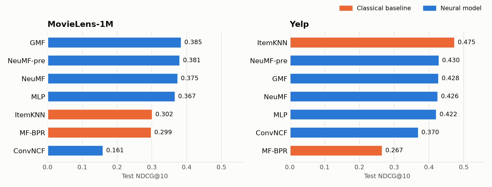
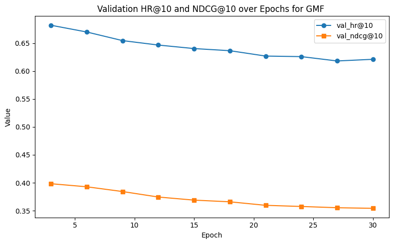
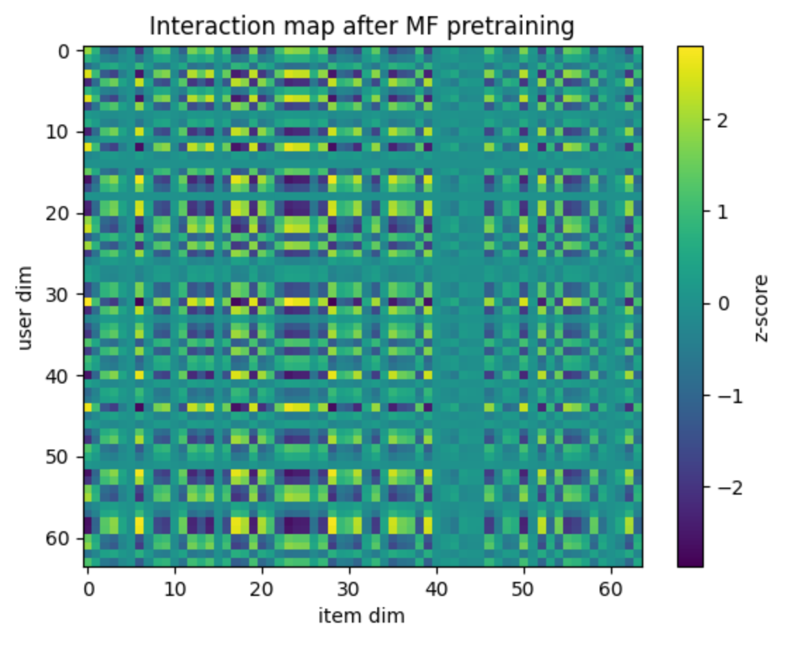

# Comparing Classical and Neural Collaborative Filtering on Implicit Feedback

A controlled comparison of ItemKNN, MF-BPR, GMF, MLP, NeuMF and ConvNCF on MovieLens-1M and Yelp.
The question is whether deep recommenders beat well-tuned classical baselines.

Bachelor's thesis (Senior Project), University College Roosevelt, Middelburg · **G. V. Vetsler**
· Supervisor: Dr. Marijn Jansen · Second examiner: Dr. Tamas Vinko

**📄 [Read the full thesis (PDF)](paper/thesis.pdf)** · [Presentation slides (PDF)](paper/presentation.pdf)

---

## Overview

Recommender systems mostly learn from *implicit* feedback (clicks, views, ratings given at all), where
a missing interaction does not mean dislike. Neural models such as **NeuMF** (He et al., 2017) and
**ConvNCF** (He et al., 2018) report large gains over matrix factorisation and neighbourhood methods.
Later critical studies (Rendle et al., 2020; Anelli et al., 2021) argue that these gains shrink or vanish
once the baselines are tuned properly.

This thesis re-implements two classical baselines and five neural models from the original papers and
evaluates all of them under one leave-one-out protocol on two standard implicit-feedback benchmarks. It
also runs NeuMF on Yelp and ConvNCF on MovieLens, combinations the original papers did not evaluate.

**Outcome.** A shallow neural MF model (GMF) is the most accurate model on MovieLens. A simple item-based
KNN is the most accurate on Yelp. The deeper architectures (MLP, NeuMF, and in particular ConvNCF) do not
turn their extra capacity into better rankings under a realistic tuning and compute budget.

## Research questions

1. Are MLP-based models (MLP, NeuMF) a good fit for collaborative filtering data?
2. Does ConvNCF's outer-product interaction map contain spatial structure that a CNN can exploit?
3. To what extent does deep learning help collaborative filtering?

## Main results



Test set, one held-out item per user ranked against 99 sampled negatives. Best value per column in bold.
A random ranking would give HR@10 ≈ 0.10.

| Model | Type | MovieLens HR@10 | MovieLens NDCG@10 | Yelp HR@10 | Yelp NDCG@10 |
|---|---|---|---|---|---|
| ItemKNN | classical | 0.5204 | 0.3022 | **0.7301** | **0.4747** |
| MF-BPR | classical | 0.5379 | 0.2989 | 0.4329 | 0.2666 |
| GMF | neural | **0.6629** | **0.3853** | 0.6775 | 0.4284 |
| MLP | neural | 0.6358 | 0.3675 | 0.6787 | 0.4224 |
| NeuMF | neural | 0.6457 | 0.3752 | 0.6744 | 0.4264 |
| NeuMF-pre | neural | 0.6480 | 0.3814 | 0.6917 | 0.4297 |
| ConvNCF | neural | 0.3220 | 0.1606 | 0.6242 | 0.3702 |

These are the thesis numbers (Tables 18–19). K = 5 and K = 20 are in
[`results/movielens.csv`](results/movielens.csv) and [`results/yelp.csv`](results/yelp.csv).

> **Post-submission check.** While preparing this repository, the ItemKNN evaluation turned out to break
> score ties in favour of the held-out item and to use a different scoring rule than the one the thesis
> describes. Re-evaluated as described (`src/cfcompare/knn.py`), ItemKNN reaches NDCG@10 = 0.385 on
> MovieLens (level with GMF) and 0.476 on Yelp (still the best model). The conclusions stand. Details
> and the other issues found are in [REPRODUCIBILITY.md](REPRODUCIBILITY.md).

## Key findings

- **Depth did not help.** GMF, the shallowest neural model, has the best NDCG@K on MovieLens at every
  cut-off. MLP, NeuMF and NeuMF-pre match it or trail slightly. On Yelp the four MF-style neural models
  lie within 0.008 NDCG@10 of each other.
- **The MF-style neural models overfit early.** For GMF, MLP and NeuMF, training accuracy approaches 1.0
  while validation HR/NDCG peak within the first 3–12 epochs and then decline, so validation-based
  early stopping is essential. ConvNCF shows the opposite: it underfits Yelp within 30 epochs.
- **Pretraining gives a small, consistent gain.** NeuMF-pre beats NeuMF without pretraining on both datasets.
- **ConvNCF did not pay off.** It is the most expensive model, yet the weakest on MovieLens and mid-range
  on Yelp, where ItemKNN outperforms it. Embedding dimensions have no natural order, so the outer-product
  map lacks the spatial locality convolutions rely on (in line with Anelli et al.).
- **Strong baselines matter.** Learned embeddings clearly beat the classical baselines on MovieLens, but
  the neighbourhood model wins on the sparser Yelp data. Together this supports the view that
  well-regularised MF-style and neighbourhood methods remain hard to beat.

<table>
<tr>
<td width="50%"></td>
<td width="50%"></td>
</tr>
<tr>
<td>GMF on MovieLens: validation accuracy is highest at epoch 3 and falls afterwards (thesis Fig. 11).</td>
<td>The outer-product interaction map that ConvNCF convolves over, after MF pretraining on Yelp (thesis Fig. 30).</td>
</tr>
</table>

## Methods

| Family | Model | Idea | Loss |
|---|---|---|---|
| Classical | **ItemKNN** | cosine similarity between items; score = sum of the candidate's similarities to those of its K nearest neighbours the user has interacted with | none (memory-based) |
| Classical | **MF-BPR** | inner product of user and item embeddings | pair-wise BPR |
| Neural | **GMF** | element-wise product of embeddings, then a learned output layer | point-wise BCE |
| Neural | **MLP** | concatenated embeddings passed through a [32, 16, 8] ReLU tower | point-wise BCE |
| Neural | **NeuMF** | GMF and MLP branches fused in one prediction layer | point-wise BCE |
| Neural | **NeuMF-pre** | NeuMF initialised from trained GMF and MLP (α = 0.5) | point-wise BCE |
| Neural | **ConvNCF** | 64 × 64 outer-product map passed to a shallow CNN, initialised from MF-BPR | pair-wise BPR |

## Datasets

| | MovieLens-1M | Yelp |
|---|---|---|
| Users | 6,040 | 24,930 |
| Items | 3,706 | 25,799 |
| Interactions | 1,000,209 | 690,381 |
| Density | 4.47 % | 0.11 % |
| Avg. interactions per user | 165.6 | 27.7 |

Statistics as reported in Tables 1–2 of the thesis. Every rating counts as a positive interaction.
The Yelp statistics describe the de-duplicated data, while the experiments used the raw file with
25,677 users (see [REPRODUCIBILITY.md](REPRODUCIBILITY.md)). Neither dataset is redistributed here;
[`data/README.md`](data/README.md) has download commands and checksums.

## Experimental setup

- **Split (leave-one-out by time).** Each user's most recent interaction is the test item and the
  second most recent is the validation item. Everything else is training data.
- **Negative sampling.** Point-wise models see 4 sampled unobserved items per positive. MF-BPR trains on
  (user, positive, negative) triplets with 4 negatives per positive, or 1 on Yelp. ConvNCF uses 1 negative on
  Yelp; the MovieLens notebook uses 4.
- **Training.** Embedding size 64, batch size 256, 30 epochs (50 for MF-BPR). Adam (1e-3) for the
  point-wise models, Adagrad (0.05) for the BPR models.
- **Model selection.** Validation HR@10 and NDCG@10 are computed every 3 epochs. The checkpoint with the
  best validation NDCG@10 (HR@10 breaks ties) is evaluated once on the test split.
- **Tuning.** ItemKNN tunes its neighbourhood size. ConvNCF runs a grid over L2 regularisation of the
  embedding, convolution and output layers ({1e-3, 1e-1, 0}). NeuMF-pre on Yelp tunes the learning rate
  ({1e-4, 5e-4, 1e-3, 5e-3}, best 1e-4).

## Evaluation metrics

For each test user, the held-out item is ranked against **99 items the user never interacted with**, and
the top K of the ranked list count as recommendations.

- **HR@K (Hit Ratio):** the fraction of users whose held-out item appears in their top K.
- **NDCG@K (Normalised Discounted Cumulative Gain):** like HR, but a hit at rank *p* is worth
  1 / log₂(p + 1). A hit at rank 1 scores 1.0 and a hit at rank 10 scores 0.29, so NDCG rewards placing
  the correct item near the top.

NDCG@10 is the primary selection metric throughout.

## Reproducing the experiments

```bash
pip install -r requirements.txt       # Python 3.12; see the file for tested versions
```

1. **Get the data** into `data/` ([instructions](data/README.md)), then check it against Tables 1–2:
   ```bash
   python scripts/dataset_stats.py
   ```
2. **Smoke test** every model on a 1 % user sample for one epoch (under 10 minutes on a laptop CPU):
   ```bash
   python tests/make_sample.py
   python tests/smoke_test.py
   ```
3. **Run an experiment** with the thesis hyperparameters (`--help` lists the overrides):
   ```bash
   python scripts/run_experiment.py --model itemknn   --dataset yelp        # ~6 min on CPU
   python scripts/run_experiment.py --model gmf       --dataset movielens   # GPU recommended
   python scripts/run_experiment.py --model convncf   --dataset yelp        # GPU required in practice
   ```
   Models: `itemknn`, `mf-bpr`, `gmf`, `mlp`, `neumf`, `neumf-pre`, `convncf`. Each run writes
   `metrics.json` (config, validation curve, best epoch, test HR/NDCG@{5,10,20}) and training plots to
   `results/runs/<dataset>/<model>/`.
4. **Regenerate the results figure** from `results/*.csv`:
   ```bash
   python scripts/plot_results.py
   ```

The neural models were trained on Kaggle GPUs. On a CPU, the full 30-epoch runs take many hours.

### Which code produces which result

| Thesis result | Original notebook | Command |
|---|---|---|
| Tables 1–2 (datasets) | – | `scripts/dataset_stats.py` |
| §5.1, Tables 4–5, Figs. 4–5 (ItemKNN) | [01_itemknn](notebooks/01_itemknn.ipynb) | `--model itemknn` |
| §5.2, Tables 6–7, Figs. 6–9 (MF-BPR) | not exported from Kaggle | `--model mf-bpr` |
| §5.3–5.5, 5.7, MovieLens (GMF, MLP, NeuMF, NeuMF-pre) | [02_ncf_movielens](notebooks/02_ncf_movielens.ipynb), [03_neumf_pretrained_movielens](notebooks/03_neumf_pretrained_movielens.ipynb) | `--model gmf` / `mlp` / `neumf` / `neumf-pre` |
| §5.3–5.5, 5.7, Yelp | [04_ncf_yelp](notebooks/04_ncf_yelp.ipynb) | same, `--dataset yelp` |
| §5.6.1, Table 14, Figs. 22–23 (ConvNCF) | [05_convncf_movielens](notebooks/05_convncf_movielens.ipynb) | `--model convncf` |
| §5.6.2, Table 15, Figs. 24–25 (ConvNCF) | [06_convncf_yelp](notebooks/06_convncf_yelp.ipynb) | `--model convncf --dataset yelp` |
| Tables 18–19, results figure | – | `scripts/plot_results.py` |

The notebooks are the code the thesis numbers come from, and each starts with a header naming the
tables and figures it produces. Set `DATA_DIR` in their first code cell to run them. `src/cfcompare` is
a consolidated re-implementation of the same models and protocol with the issues in
[REPRODUCIBILITY.md](REPRODUCIBILITY.md) fixed, so its numbers can differ slightly from the thesis.

## Repository structure

```
├── paper/
│   ├── thesis.pdf              the thesis as submitted
│   ├── presentation.pdf        final presentation slides
│   └── latex/                  LaTeX sources, bibliography and all figures
├── notebooks/                  original experiment notebooks (Kaggle), one per thesis section
│   └── supplementary/          ConvNCF L2 searches (shallow and deep variants)
├── src/cfcompare/              re-implementation: data.py, metrics.py, knn.py, ncf.py, bpr.py,
│                               config.py (thesis hyperparameters), experiments.py (training loop)
├── scripts/                    run_experiment.py, dataset_stats.py, plot_results.py
├── tests/                      1 % dataset sampler and end-to-end smoke test
├── results/                    reported metrics (CSV), figure, re-evaluated runs (reproduced/)
├── data/                       datasets go here (not tracked)
└── REPRODUCIBILITY.md          discrepancies found between thesis text and code, and how to read them
```

To rebuild the PDFs: `cd paper/latex`, then
`pdflatex thesis && bibtex thesis && pdflatex thesis && pdflatex thesis` (and `pdflatex presentation` twice).

## Limitations and future work

From Section 7 of the thesis:

- **Limited hyperparameter search.** A single embedding size (64), a fixed batch size and architecture,
  and small learning-rate and L2 grids. Heavier tuning might improve NeuMF and MLP and change their order.
- **Short training.** 30 epochs (50 for MF-BPR), against up to 1,500 for ConvNCF in the original paper.
  MF-BPR and ConvNCF on Yelp were still improving when training stopped.
- **Shallow ConvNCF only.** Deeper variants were unstable in preliminary runs, so the conclusions apply to
  a feasible shallow ConvNCF, not to a full reproduction of the original.
- **Simple negative sampling.** Uniform sampling with a fixed ratio. Tuning it, or using popularity-based or
  hard negatives, could change the pair-wise vs. point-wise comparison.
- **Accuracy metrics only.** Coverage, diversity and novelty, where neural models may differ, were not measured.

The thesis proposes a broader hyperparameter search with longer training, adding graph-based
(LightGCN, NGCF) and sequential recommenders, and evaluating cold-start scenarios.

## Citation

```bibtex
@thesis{vetsler2025cf,
  author = {Vetsler, G. V.},
  title  = {Comparing classical and neural collaborative filtering models on implicit feedback data},
  school = {University College Roosevelt},
  type   = {Bachelor's thesis},
  year   = {2025}
}
```

## References

- X. He, L. Liao, H. Zhang, L. Nie, X. Hu, T.-S. Chua. [Neural Collaborative Filtering](https://arxiv.org/abs/1708.05031). WWW 2017.
- X. He, X. Du, X. Wang, F. Tian, J. Tang, T.-S. Chua. [Outer Product-based Neural Collaborative Filtering](https://arxiv.org/abs/1808.03912). IJCAI 2018.
- S. Rendle, C. Freudenthaler, Z. Gantner, L. Schmidt-Thieme. BPR: Bayesian Personalized Ranking from Implicit Feedback. UAI 2009.
- S. Rendle, W. Krichene, L. Zhang, J. Anderson. [Neural Collaborative Filtering vs. Matrix Factorization Revisited](https://arxiv.org/abs/2005.09683). RecSys 2020.
- V. W. Anelli, A. Bellogín, T. Di Noia, E. Di Sciascio, F. Narducci. [Reenvisioning the Comparison between Neural Collaborative Filtering and Matrix Factorization](https://arxiv.org/abs/2107.13472). RecSys 2021.

The full bibliography is in the [thesis](paper/thesis.pdf).

## License

Code: [MIT](LICENSE). The thesis, slides and their LaTeX sources in `paper/` remain © the author.
MovieLens and Yelp are subject to their own terms and are not redistributed.
